<p align="center">
  
</p>

<h1 align="center">COST-IT Mobile</h1>

<p align="center">
  <strong>🏗️ A Full-Stack E-Commerce Marketplace Built for the Construction Industry</strong>
</p>

COST-IT is a digital-first construction commerce platform built in **Flutter** that empowers suppliers, contractors, and individual buyers to seamlessly buy, sell, and procure construction materials, heavy machinery, tools, and professional services in one trusted ecosystem — with full **Light & Dark Mode** support.

---

## 📱 App Screenshots

### 1. Onboarding, Authentication & Account Recovery
| Onboarding & Guest Entry | Email & Phone Login | Google OAuth Sign-In (Dark) | Identity & Password Recovery |
| :---: | :---: | :---: | :---: |
|  | 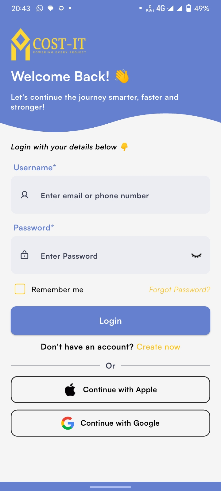 | 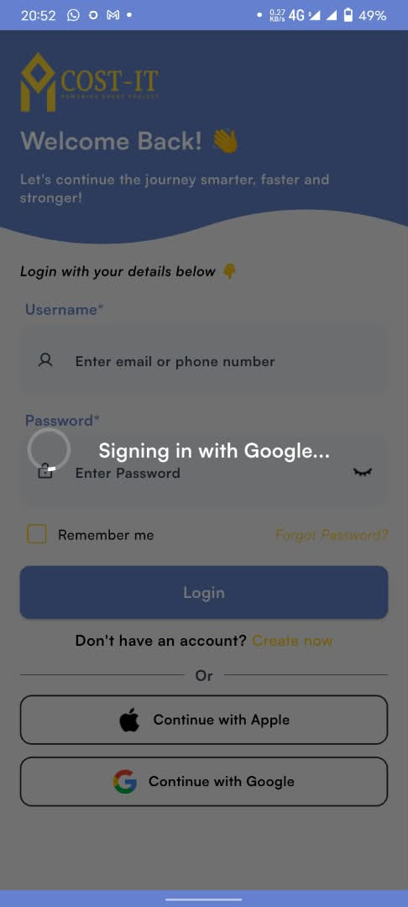 | 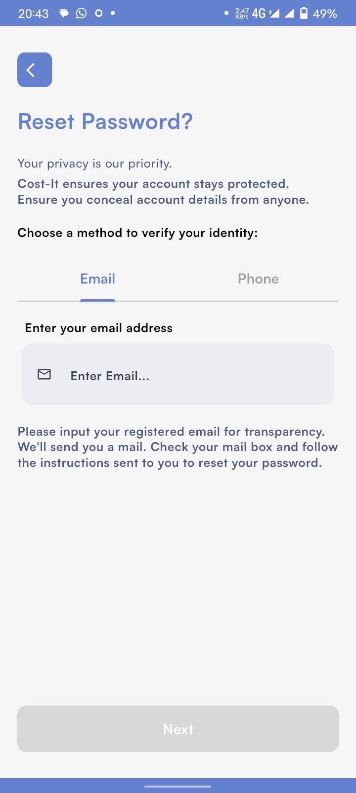 |
| *Animated hero onboarding with frosted glass CTA & guest mode* | *Unified email/phone login with Apple & Google OAuth* | *One-tap Google Sign-In flow in Dark Mode* | *Multi-channel (Email / Phone) identity verification* |

### 2. Marketplace Discovery, Search & Personalized Feeds (Light Mode)
| Explore & Special Offers | Search & Trending Tags | Trending Construction Grid | Personalized "For You" Feed |
| :---: | :---: | :---: | :---: |
| 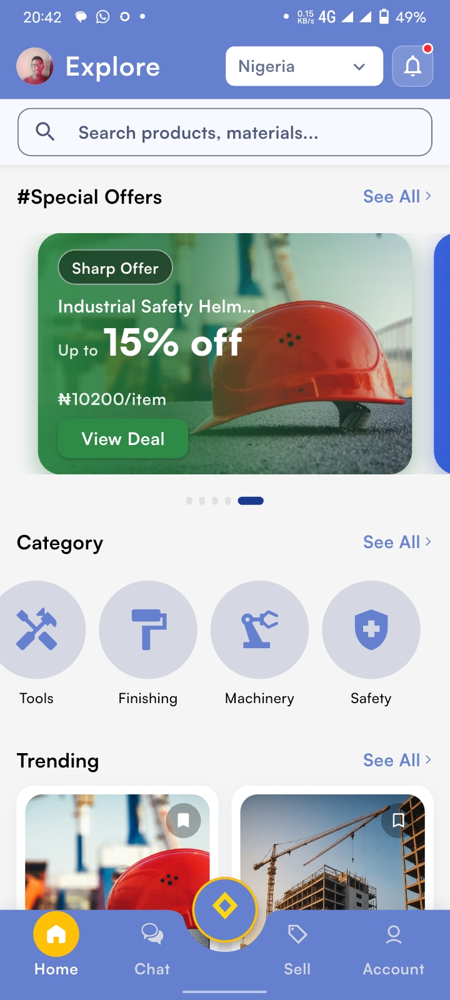 | 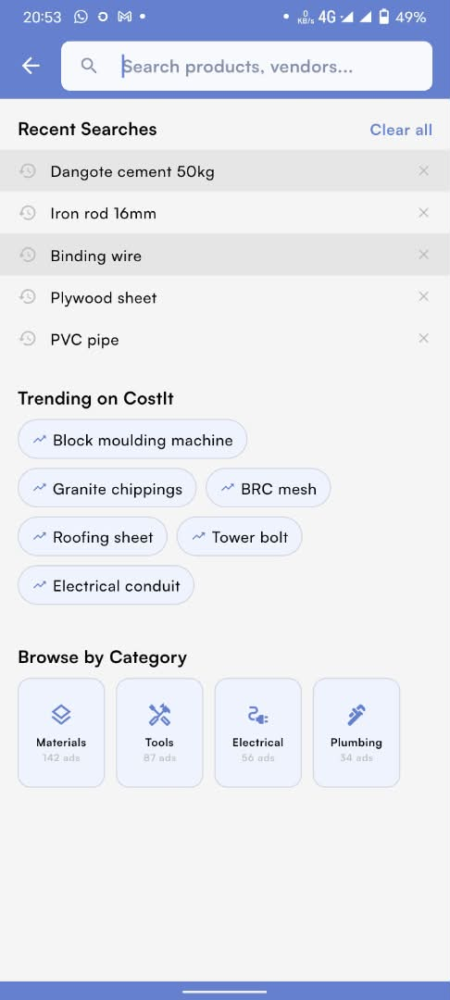 | 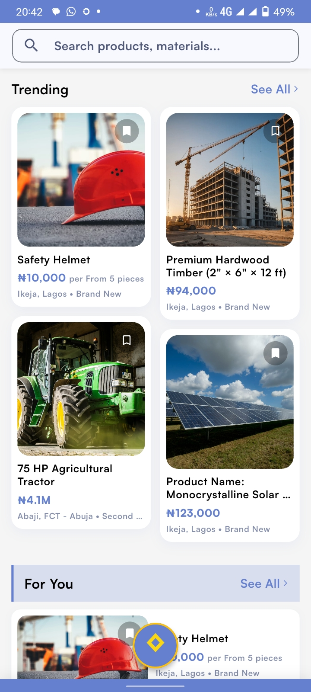 | 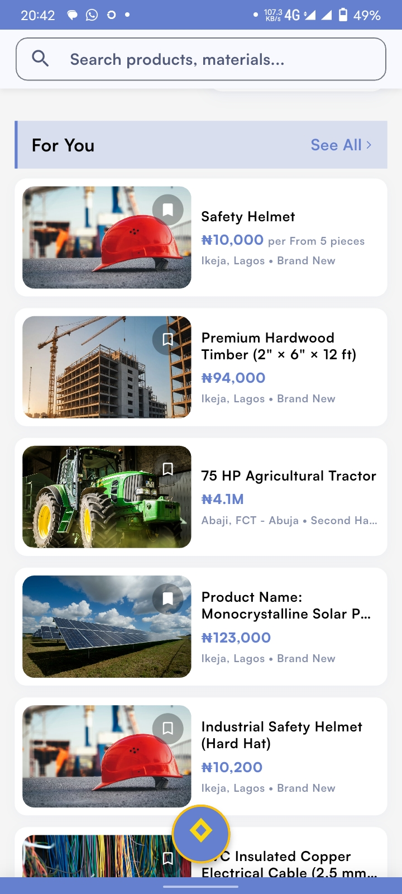 |
| *Location-aware home feed, promotional deals & category navigation* | *Recent search history, trending construction tags & category counts* | *Staggered grid feed for materials, timber & heavy equipment* | *Curated horizontal list cards with bulk pricing indicators* |

### 3. Dark Mode Experience & Product Details
| Explore Feed (Dark Mode) | Category Filtering (Dark Mode) | Product Detail & Quick Deal | Vendor Actions & Reporting |
| :---: | :---: | :---: | :---: |
| 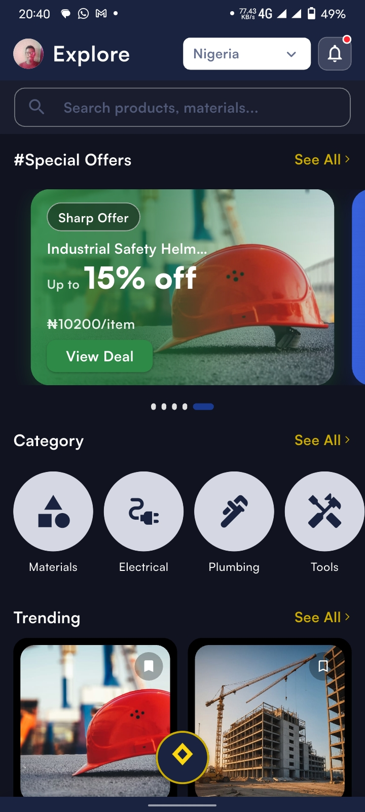 | 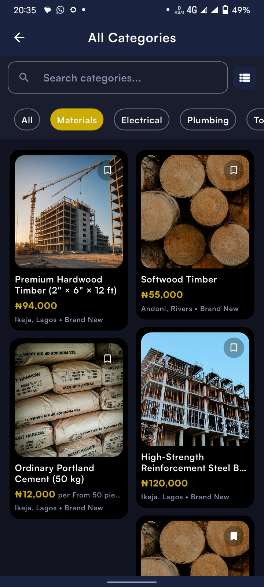 | 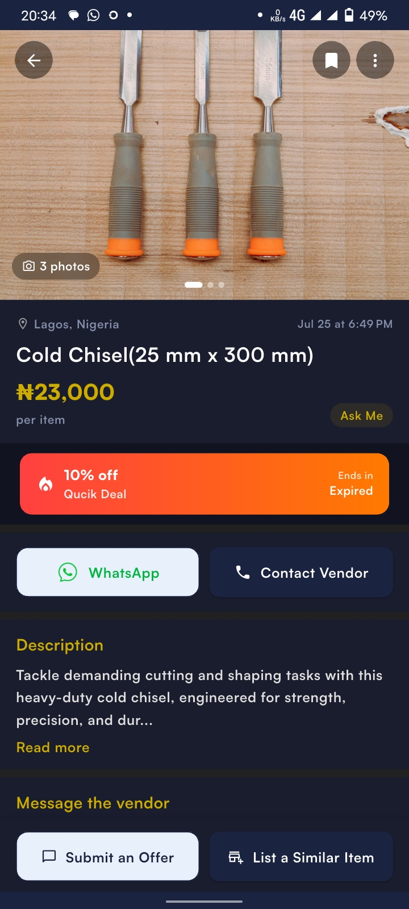 | 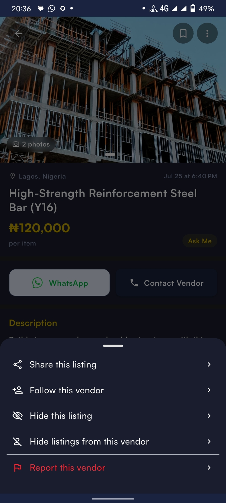 |
| *Full adaptive Dark Mode across home & special offers* | *Filterable category chips & product grid in Dark Mode* | *Multi-photo PDP with promotional deal banner & vendor contact CTAs* | *Contextual bottom sheet to share, follow vendor, or report listings* |

### 4. Vendor Listing, Messaging, Profile & Settings
| List an Item & Location Sheet | In-App Vendor Messaging | My Profile & Vendor Hub | Security, Alerts & Theme Settings |
| :---: | :---: | :---: | :---: |
| 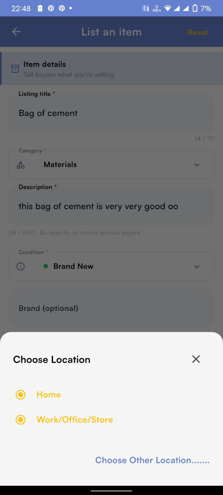 |  | 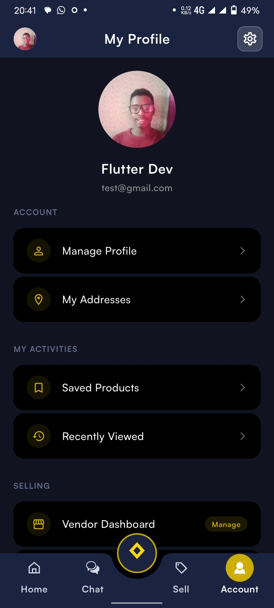 | 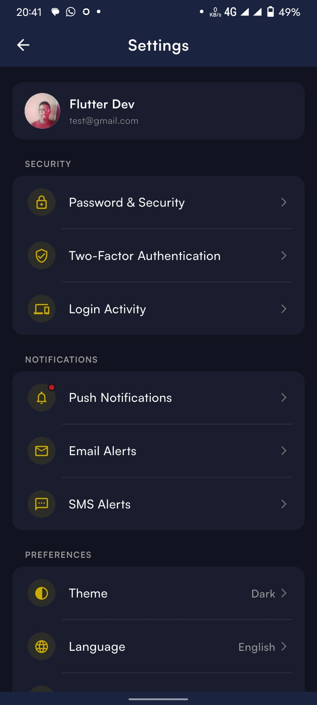 |
| *Vendor listing workflow with saved address & custom location selector* | *Real-time buyer-vendor price negotiation & contact invitations* | *Account hub with saved products, recently viewed & vendor dashboard* | *2FA security, push/email/SMS alerts & Light/Dark theme switcher* |

---

## 📁 Project Architecture (Portfolio Showcase)

> **Note:** To respect company confidentiality and intellectual property, proprietary business logic and internal credentials have been omitted from this public repository. The complete directory tree, modular feature structure, and `.dart` file layout are preserved to showcase the application's architecture and engineering contributions.

```text
lib/
├── app/                  # Root application setup, theme configuration & splash orchestration
├── components/           # Reusable navigation shells, drawers & shared UI components
├── constants/            # Application-wide design tokens, constants & asset paths
├── extensions/           # Dart & Flutter convenience extensions
├── feature/              # Feature-first modular architecture
│   ├── account/          # User profile, saved addresses & location management
│   ├── auth/             # Authentication, Google/Apple Sign-In, phone & OTP verification
│   ├── billing/          # Subscription plans, billing tiers & plan feature gating
│   ├── chat/             # Buyer-vendor real-time messaging & permission gates
│   ├── location/         # Geolocation services, address resolution & state selection
│   ├── notifications/    # In-app & push notification management
│   ├── products/         # Construction marketplace catalog, categories & special offers
│   ├── settings/         # User preferences, security & app settings
│   └── vendor/           # Vendor storefront, product listings, discounts & PDP management
├── route/                # Centralized routing & navigation configuration
├── Screens/              # Core application & onboarding screens
├── shared/               # Shared search bar, networking & utility widgets
└── widgets/              # Common atomic design widgets
```

---

## 🛠️ Tech Stack & Key Capabilities

- **Framework:** Flutter (Dart `^3.9.0`)
- **State Management:** Riverpod (`flutter_riverpod`)
- **Networking & Local Persistence:** `dio`, `http`, `hive`, `shared_preferences`
- **Authentication:** OAuth (`google_sign_in`, `sign_in_with_apple`), Phone & OTP Verification (`pinput`, `intl_phone_field`)
- **Location & Address Management:** `geolocator`, `geocoding`, multi-address profiles (`Home`, `Work/Office/Store`)
- **UI, Theming & Animations:** Adaptive Light/Dark Theme, `flutter_screenutil`, `lottie`, `shimmer`, `flutter_staggered_animations`, `flutter_staggered_grid_view`, custom `Satoshi` typography
